# Проектирование ИС электронной очереди РР2

# ВВЕДЕНИЕ

Публичный репозиторий проекта https://github.com/iONEimee/electronic-queue. Проектирование продолжает первую рейтинговую работу по разработке информационной системы электронно-информационной очереди. Исходными решениями являются язык Python, модули TicketGenerator и QueueManager, сущности Ticket и Service, а также пять требований к выдаче талона, табло, вызову посетителя, истории и статистике [2].

Предметная область охватывает очное обслуживание посетителей в учреждении с несколькими окнами. При живой очереди посетителю трудно определить порядок вызова, оператору приходится координировать поток вручную, а руководитель не получает сопоставимых данных об ожидании. Электронная очередь регистрирует обращение, назначает номер и связывает обслуживание с окном. Результат услуги, например оформление документа, остаётся во внешнем делопроизводстве.

Цель работы состоит в разработке согласованного проекта ИС, который раскрывает структуру, поведение, интерфейс, требования к качеству и порядок внедрения электронной очереди. Объект исследования — процесс управления потоком посетителей. Предмет исследования — методы проектирования этого процесса и обеспечивающей его информационной системы. Для достижения цели необходимо сохранить преемственность РР1, сформировать требования, построить взаимосвязанные модели, разработать прототип и определить условия последующей реализации и приёмки.

Граница проекта включает выдачу талона на выбранную услугу, ожидание, вызов к окну, фиксацию начала и окончания обслуживания, обработку отмены и неявки, ведение справочников и обезличенную аналитику. Онлайн-запись, льготные категории, платежи и медицинские данные в первую версию не включены. Рассматривается типовое учреждение без привязки к вымышленной организации. Параметры нагрузки и времени в работе являются проектными целями для проверки на пилоте.

В таблице 1 повторена исходная ИСР РР1. Коды и названия этапов сохранены. Детализация результатов РР2 развивает содержание этих этапов и не заменяет их новой структурой.

Таблица 1. ИСР первой работы и результаты проектирования
| Код | Этап ИСР из РР1 | Результат в РР2 |
| --- | --- | --- |
| 1.1 | Анализ требований | Границы системы, объекты и проверяемые требования |
| 1.2 | Проектирование архитектуры | BPMN, IDEF0, ER, UML, интерфейс и ТЗ |
| 1.3 | Разработка модуля талонов | Проект TicketGenerator и модель талона, экран выдачи |
| 1.4 | Разработка логики очереди | Правила FIFO, сценарии оператора и состояния |
| 1.5 | Тестирование | Приёмочные критерии и проверка локального прототипа |

# 1 Предметная область и требования

## 1.1 Преемственность проекта и правила обслуживания

Задача раздела — определить единую основу для всех моделей. В РР1 использована каскадная последовательность этапов ИСР. Сохранённый снимок исходного репозитория соответствует коммиту develop 408e1b8bba8036013b1a76cd841f2d5b3c7e37bb от проверенного состояния проекта. В нём представлены требования и заготовки модулей, а не завершённое веб-приложение [2].

В исходной таблице ИСР этапу 1.4 сопоставлена ветка feature/queue-logic; в сохранённом состоянии проекта модуль очереди связан с feature/queue-module. Это различие имён не меняет содержания этапа. Номер талона проектируется строковым, поскольку генератор РР1 использует префикс услуги. Целочисленный тип number в заготовке модели данных подлежит замене при реализации. Сведения РР1 о готовности программы и испытаниях не используются как доказательство работоспособности разрабатываемого решения.

Для первой версии выбран порядок FIFO отдельно по услугам. Оператор получает самый ранний ожидающий талон среди услуг своего окна. При одинаковом времени создания порядок определяется идентификатором талона. В каждый момент у окна может быть не более одного талона в состоянии called или in_service. Номер вида A-003 удобен посетителю, но уникальным ключом данных служит UUID. Полная уникальность порядкового номера обеспечивается сочетанием услуги, рабочей даты и последовательности.

Рабочая дата определяется по зоне Europe/Moscow, моменты событий сохраняются в UTC. При смене даты начинается новая последовательность, а история прежней даты сохраняется. Незакрытые обращения предыдущего дня разбираются ответственным сотрудником до открытия смены; они не переносятся в новую очередь автоматически. Приостановление услуги запрещает новую выдачу, но сохраняет обслуживание уже выданных талонов.

Посетитель может отменить свой ещё ожидающий талон. После вызова оператор либо начинает обслуживание, либо после двух минут ожидания фиксирует неявку. Повторный вызов не меняет состояние и не обнуляет время первоначального вызова. Две минуты — выбранный параметр учебного проекта, который уточняется перед пилотом. Завершённый, отменённый и пропущенный талон не возвращается в очередь. Новый визит оформляется новым талоном. Эти правила согласуют данные, диаграммы и интерфейс.

## 1.2 Классификация объектов предметной области

Объекты разделены на участников, справочники, операционные данные и управляющие службы. Посетитель является внешним участником; его ФИО не требуется для управления очередью. Учётная запись сотрудника, напротив, нужна для проверки полномочий и аудита действий. Классификация объектов приведена в таблице 2.

Таблица 2. Группы объектов и связи
| Группа | Объект и основные атрибуты | Связь и назначение |
| --- | --- | --- |
| Участники | Посетитель; оператор; администратор | Посетитель получает талон; сотрудники выполняют действия по ролям |
| Справочники | Service — код, префикс, название, доступность | Одна услуга объединяет множество талонов |
| Рабочие места | Window — номер, оператор, доступность | Окно обслуживает набор услуг через WindowService |
| Операционные данные | Ticket — UUID, номер, услуга, дата, статус, время | Один талон относится к одной услуге и не более чем одному окну |
| История | TicketEvent — талон, событие, время, инициатор | История объясняет каждую смену состояния |
| Управляющие службы | TicketGenerator; QueueManager; StatisticsService | Создание талона, выбор очередного, расчёт показателей |
| Служебные данные | DailyCounter; IdempotencyKey | Уникальная последовательность и защита от повторной выдачи |

Классификация отделяет объект обслуживания от его программной обработки. Очередь не становится второй независимой копией списка талонов: она определяется выборкой Ticket со статусом waiting. Благодаря этому табло, рабочие места и статистика используют одну модель состояния.

## 1.3 Функциональные и нефункциональные требования

Функциональные требования F01–F05 сохраняют исходные задачи проекта. F06–F10 уточняют управление, доступ и исключительные сценарии. Критерии сформулированы так, чтобы результат можно было наблюдать при приёмке. Функциональные требования приведены в таблице 3.

Таблица 3. Функциональные требования
| Код | Требование | Критерий приёмки |
| --- | --- | --- |
| F01 | Выдать талон на доступную услугу с номером и временем | Номер уникален для услуги и даты; повтор одного ключа запроса не создаёт второй талон |
| F02 | Показывать вызванный номер и окно на табло | После вызова видны номер, окно и состояние; ФИО не выводится |
| F03 | Вызывать следующего для услуг выбранного окна | Выбран самый ранний waiting; занятое окно не получает второй активный талон |
| F04 | Сохранять историю обслуживания | Создание и каждый переход имеют время и запись события; история не удаляется при новом дне |
| F05 | Рассчитывать статистику ожидания | Среднее рассчитывается по завершённым талонам; пустая выборка отображается без деления на ноль |
| F06 | Управлять доступностью услуг и назначением окон | Новые талоны на закрытую услугу не выдаются; действующая история остаётся доступной |
| F07 | Разделять роли посетителя, оператора и администратора | Сервер отклоняет действие вне полномочий независимо от видимости кнопки |
| F08 | Выгружать обезличенные показатели | CSV содержит период, услуги, времена и статусы; не содержит паролей и ФИО посетителей |
| F09 | Отменять ожидающий талон по праву владения | waiting переходит в cancelled; чужой или уже вызванный талон не отменяется посетителем |
| F10 | Обрабатывать повторный вызов и неявку | Повтор сохраняет called; no_show доступен после двух минут, событие фиксируется |

Нефункциональные требования относятся к будущей серверной системе. Локальный прототип позволяет проверить взаимодействие с интерфейсом, но не подтверждает производительность, отказоустойчивость и разграничение доступа. Требования к качеству сведены в таблице 4.

Таблица 4. Требования к качеству и условия проверки
| Код | Проектное требование | Способ проверки |
| --- | --- | --- |
| N01 | Выдача и вызов — не более 2 с для 95 процентов запросов | Нагрузочный стенд, 30 сессий, до 10 окон, 1000 талонов в день |
| N02 | Обновление табло — не более 3 с после фиксации вызова | Сопоставление времени COMMIT и обновления клиента; опрос раз в 1 с |
| N03 | Доступность за часы работы — не ниже 99,5 процента | Мониторинг успешных операций за месяц пилота |
| N04 | RPO не более 24 ч, RTO не более 60 мин | Ежедневная копия и контрольное восстановление на отдельном стенде |
| N05 | Отсутствие двойного вызова и повторной выдачи | Параллельные запросы к двум окнам и повтор ключа выдачи |
| N06 | Доступ с клавиатуры; контраст текста не ниже 4,5 к 1 | Ручной проход Tab и проверка цветов; крупные кнопки терминала от 44 px |
| N07 | Время в UTC; рабочая дата в Europe/Moscow | Тест границы суток и синхронизации часов, допустимое расхождение до 5 с |
| N08 | Воспроизводимое развёртывание и журналирование | Зафиксированные зависимости, миграции БД, инструкция запуска и аудит |

Доступность интерфейса ориентирована на проверяемые принципы WCAG 2.2 [12]. Выбранная нагрузка ограничивает первую версию одним учреждением. Рост числа площадок требует отдельной оценки, а не автоматического распространения приведённых целевых значений.

# 2 Модели процессов и данных

## 2.1 Бизнес процесс в BPMN и IDEF0

Задача моделирования — показать, как требования преобразуются в последовательность действий и обмен информацией. BPMN описывает ход обслуживания, а IDEF0 выделяет входы, результаты, управляющие правила и ресурсы. Нотация BPMN опирается на спецификацию OMG [4]; трактовка сторон функционального блока IDEF0 — на первоисточник NIST [3]. Основной процесс BPMN показан на рисунке 1.

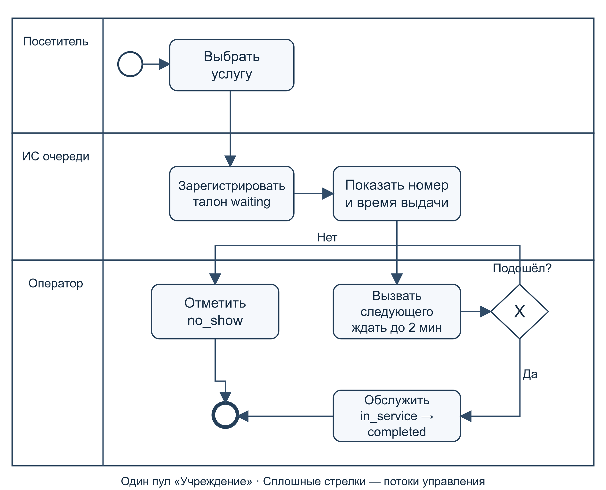
Рисунок 1. BPMN основного процесса обслуживания

На рисунке 1 один пул учреждения разделён на дорожки посетителя, информационной системы и оператора. Стартовое событие означает обращение посетителя. После выбора услуги система создаёт талон waiting и показывает номер. Оператор вызывает следующего; исключающий шлюз разделяет обслуживание пришедшего посетителя и фиксацию неявки. Скруглённые прямоугольники обозначают задачи, тонкая окружность — начало, окружность с утолщённым контуром — окончание, сплошные стрелки — поток управления. Отмена до вызова рассматривается отдельным сценарием состояния талона. Контекст IDEF0 представлен на рисунке 2.

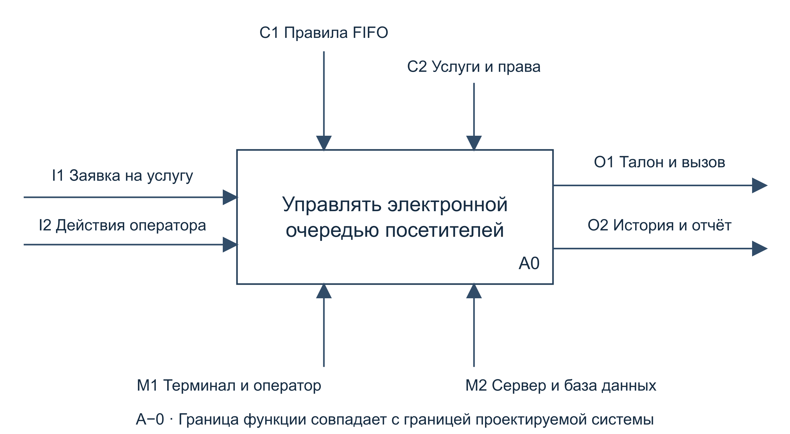
Рисунок 2. IDEF0 контекстная диаграмма A−0

Контекстная функция A0 получает заявку на услугу I1 и действия оператора I2. Управления C1 и C2 задают FIFO, справочники и права. Выход O1 включает талон и вызов, O2 — историю и отчёт. Механизмы M1 и M2 включают терминал, оператора, сервер и БД. Таким образом, оборудование не смешивается с входными данными, а регламент обслуживания не изображается как результат работы. Декомпозиция A0 показана на рисунке 3.

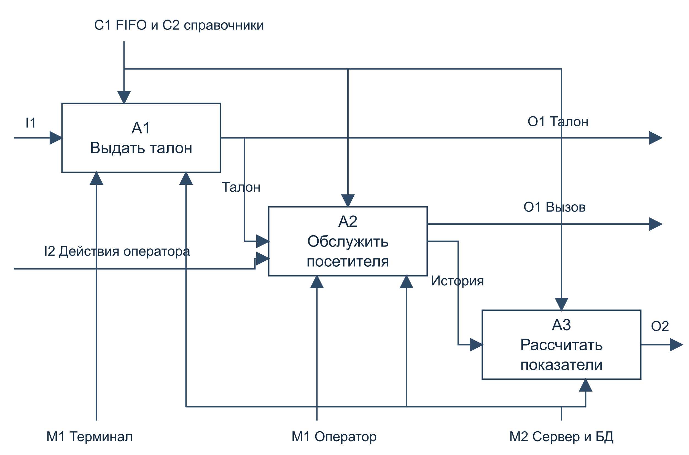
Рисунок 3. IDEF0 декомпозиция функции A0

Декомпозиция содержит выдачу талона A1, обслуживание A2 и расчёт показателей A3. Талон из A1 поступает в A2; история из A2 поступает в A3. Выходы O1 и O2, входы I1 и I2 и управления сохраняют смысл контекстной схемы. A1 соответствует F01, A2 — F02–F04, F09 и F10, A3 — F05 и F08. Разные модели описывают один процесс на разных уровнях, поэтому создаваемая история совпадает с источником статистики.

## 2.2 Архитектура и компоненты системы

Для одного учреждения выбран модульный монолит. Веб-интерфейсы обращаются к единому API; прикладные модули выполняются в одном серверном приложении и используют общее транзакционное хранилище. Такое решение сохраняет модульность Python из РР1 и не требует распределённой координации нескольких сервисов. Компоненты системы показаны на рисунке 4.

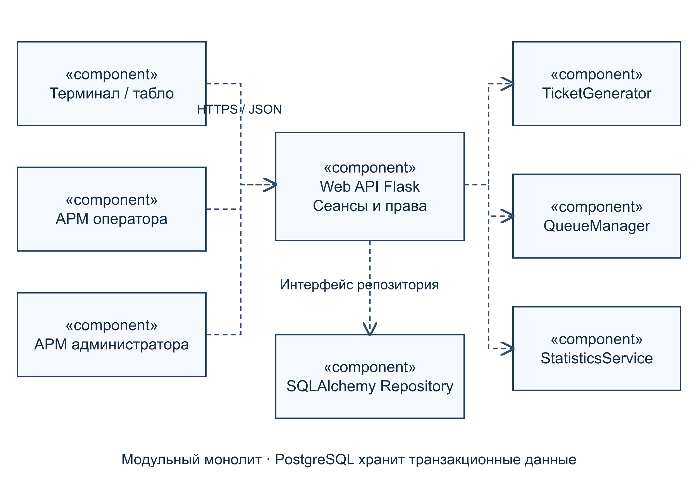
Рисунок 4. UML компонентов и архитектура модульного монолита

Терминал создаёт обращения, табло читает активные вызовы, АРМ оператора управляет обслуживанием, АРМ администратора меняет справочники и получает отчёты. Web API проверяет сеанс и роль. TicketGenerator формирует талон, QueueManager выполняет переходы и выбор следующего, StatisticsService строит агрегаты. Компонент Repository на SQLAlchemy отделяет прикладные операции от таблиц. Пунктирные зависимости UML обозначают использование интерфейсов [5].

Клиент не назначает себе роль и не выбирает произвольный новый статус. Он отправляет команду, например start или complete; сервер проверяет её допустимость. Если сервер недоступен, клиент показывает ошибку и не имитирует успешную выдачу. Граница транзакции включает изменение Ticket и добавление TicketEvent, что предотвращает расхождение текущего состояния с историей [11].

## 2.3 Модель данных

Реляционная модель хранит талоны независимо от визуального представления очереди. На основных ER-схемах указаны ключи и мощности связей. Символ вопроса у атрибута обозначает допустимость NULL. Модель нормализована так, чтобы название услуги и настройки окна не повторялись в каждой строке талона. Основные данные представлены на рисунке 5.

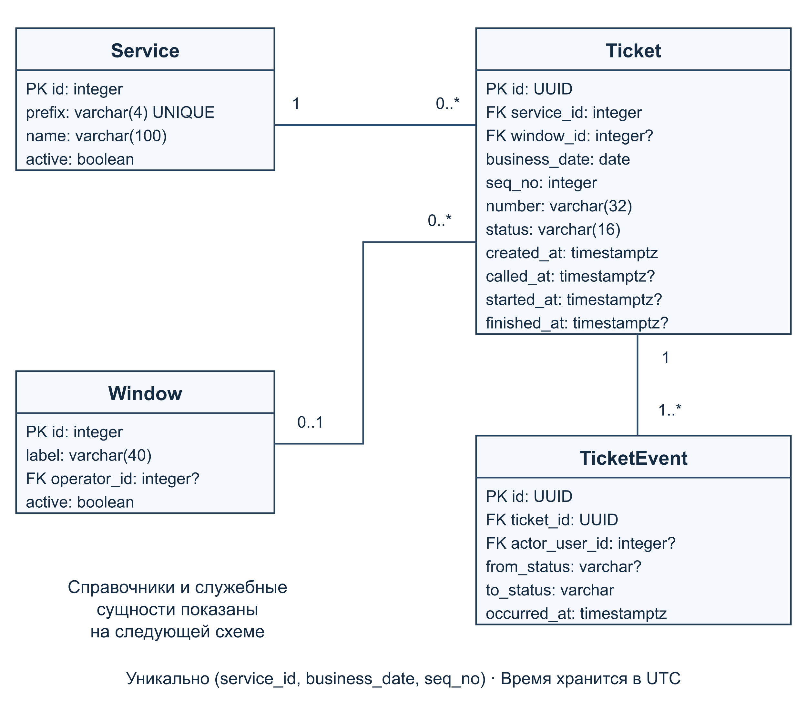
Рисунок 5. ER модель талонов и обслуживания

Service связан с Ticket как один ко многим. Ticket относится к одному окну после вызова; до вызова window_id пуст. Один талон имеет одно или несколько событий, включая событие создания. WindowService реализует связь многие ко многим между окнами и услугами. Учётная запись может быть назначена не более чем одному окну одновременно. Вспомогательные сущности представлены на рисунке 6.

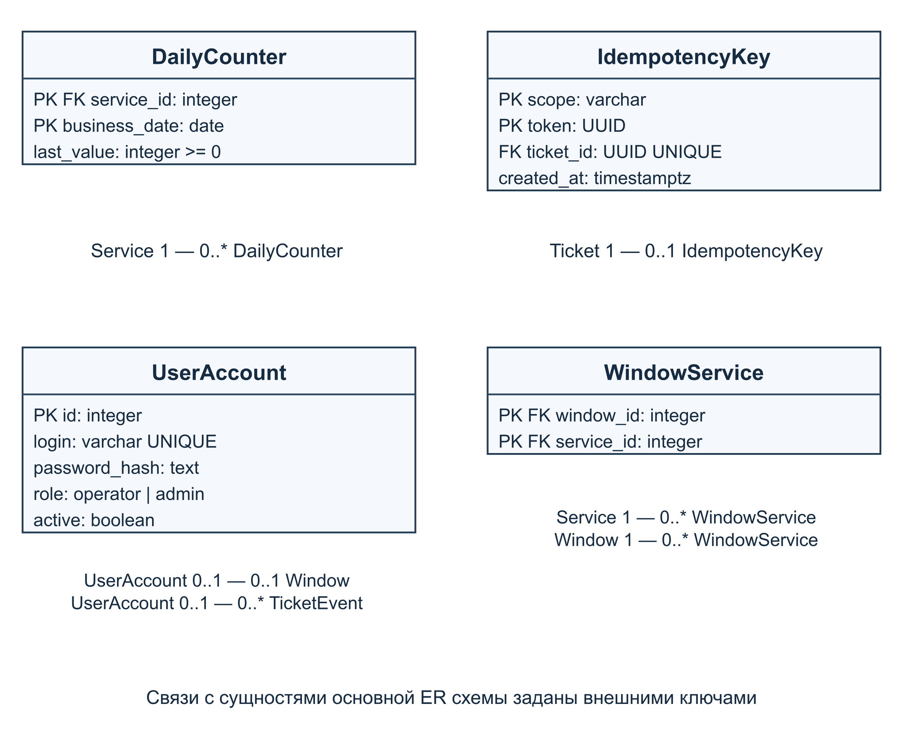
Рисунок 6. ER модель справочников и служебных данных

DailyCounter хранит последний порядковый номер для услуги и рабочей даты. IdempotencyKey связывает область и UUID клиентского запроса с уже созданным талоном. Повтор запроса возвращает прежний результат. Перед созданием талона сервер блокирует строку счётчика; увеличение номера, вставка талона, сохранение ключа и события выполняются в одной транзакции. Конкурирующая первая вставка строки счётчика обрабатывается через уникальный ключ и повтор транзакции.

Основные ограничения данных включают уникальность префикса услуги, уникальность (service_id, business_date, seq_no), положительный seq_no и допустимый набор статусов. Частичный уникальный индекс по window_id для called и in_service не допускает два активных талона у окна. Момент создания обязателен; времена вызова, начала и завершения заполняются по мере переходов. Для no_show нет started_at, для cancelled может не быть called_at. У completed времена вызова и начала обязательны и упорядочены.

Для вызова следующего блокируется строка окна, затем выбирается самый ранний waiting допустимой услуги с блокировкой строки. Операции с одним окном сериализуются. При обслуживании одной услуги несколькими окнами первая ожидающая строка блокируется с ожиданием, после чего условие статуса проверяется повторно; пропуск заблокированного первого талона не используется, поскольку требуется строгий FIFO [9]. Набросок DDL в проектных материалах задаёт структуру; допустимые переходы дополнительно проверяются прикладной службой.

## 2.4 Диаграммы классов

Диаграмма предметных классов связывает данные с допустимым поведением. Ticket содержит идентификатор, номер, статус и время; его методы соответствуют командам обслуживания. Service задаёт вид услуги, Window — рабочее место, TicketEvent — историю. Приватные атрибуты обозначены знаком минус, публичные операции — знаком плюс. Связи имеют те же мощности, что и ER-модель [5]. Предметные классы показаны на рисунке 7.

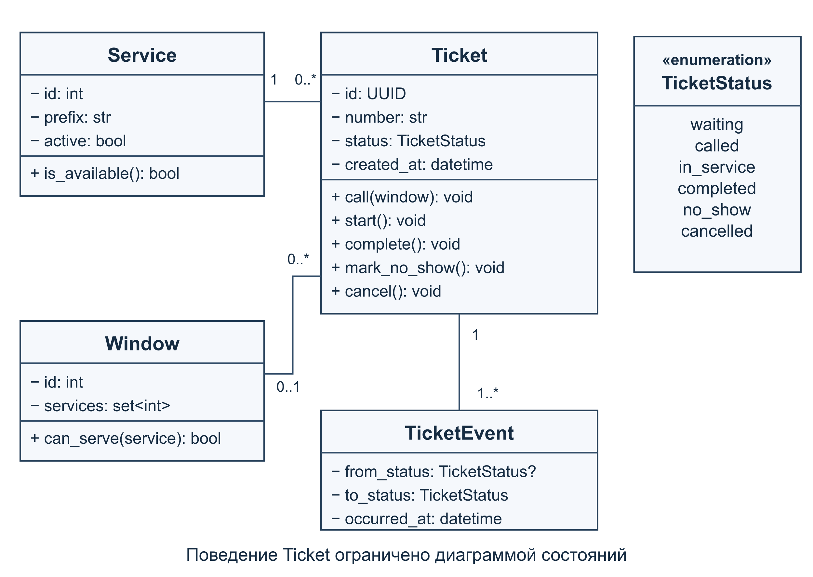
Рисунок 7. UML классов предметной области

Поведение талона не сводится к произвольной записи строки status. Метод complete допустим только после start, а mark_no_show — только после вызова и установленного ожидания. Событие создания обеспечивает непустую историю даже у ещё не вызванного талона. Service и Window используют идентификаторы и не копируют список всей очереди. Прикладные службы показаны на рисунке 8.

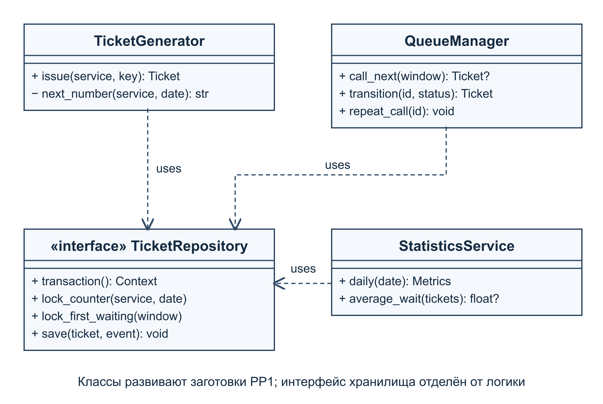
Рисунок 8. UML классов прикладных служб

TicketGenerator и QueueManager сохраняют имена исходных модулей РР1. Интерфейс TicketRepository задаёт транзакции, блокировку счётчика, поиск первого ожидающего и сохранение данных. StatisticsService читает историю обслуживания и рассчитывает метрики. Благодаря зависимости от интерфейса хранилища бизнес-правила можно проверять отдельно от конкретной СУБД; реальные блокировки при этом проверяются интеграционными тестами на PostgreSQL.

## 2.5 Диаграмма состояний талона

Жизненный цикл Ticket задаёт шесть состояний. Состояние waiting появляется после выдачи. Вызов переводит его в called, начало работы — в in_service, завершение — в completed. Альтернативные конечные состояния cancelled и no_show сохраняют причину отсутствия обслуживания и не смешиваются с успешным результатом. Переходы талона показаны на рисунке 9. Условия переходов приведены в таблице 5.

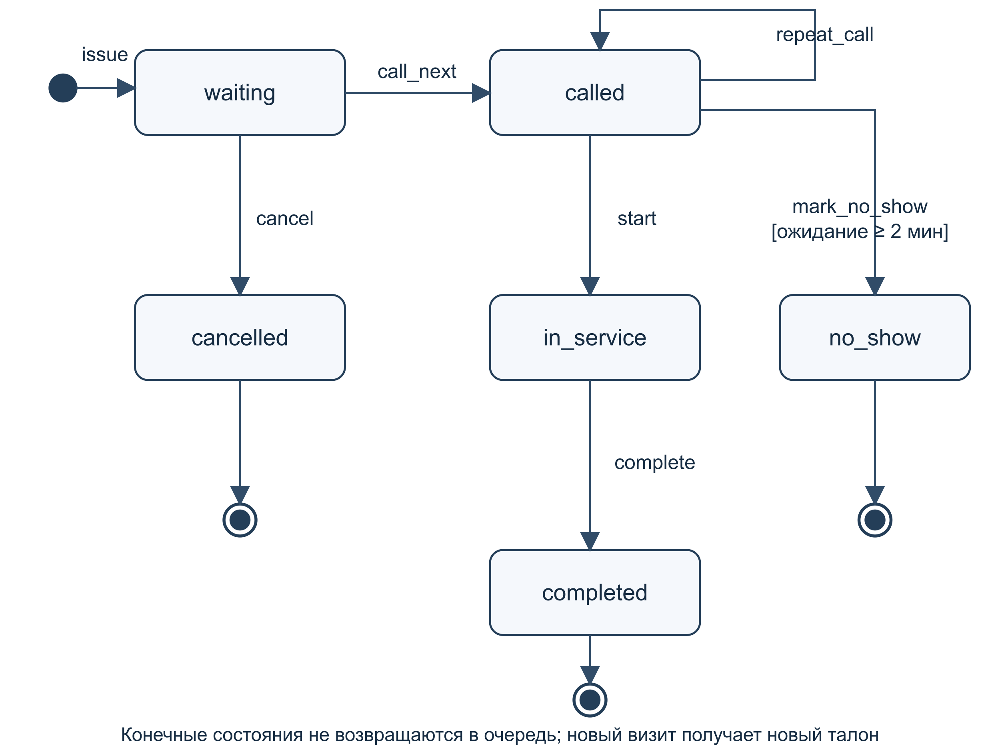
Рисунок 9. UML состояний талона

Таблица 5. Допустимые команды и условия перехода
| Команда | Исходное и новое состояние | Условие и запись времени |
| --- | --- | --- |
| issue | Начало → waiting | Услуга доступна; сохранены created_at и ключ запроса |
| call_next | waiting → called | Свободное допустимое окно; сохранён called_at |
| repeat_call | called → called | То же окно; новое событие без изменения called_at |
| start | called → in_service | Назначенный оператор; сохранён started_at |
| complete | in_service → completed | Сохранён finished_at и результат завершения |
| mark_no_show | called → no_show | Не менее 2 мин после первого вызова; сохранён finished_at |
| cancel | waiting → cancelled | Подтверждено владение талоном либо полномочие администратора |

# 3 Управление проектом и сценарии пользователей

## 3.1 Риски и меры снижения

Риски оценены как проектные предположения по шкалам вероятности P и влияния I от 1 до 5. Приоритет определяется произведением P и I. Значения 15–25 требуют обработки до пилота, 8–14 — контроля на пилоте, 1–7 — наблюдения. Оценка служит порядку работы и не представляет статистику реального внедрения. Оценки рисков приведены в таблице 6.

Таблица 6. Реестр проектных рисков
| Риск | P × I | Мера и контрольный признак | Ответственная роль |
| --- | --- | --- | --- |
| Двойной вызов одного талона | 3 × 5 = 15 | Транзакция, блокировка окна и строки; ни одного дубля в конкурентном тесте | Разработчик |
| Повтор талона после сбоя связи | 4 × 4 = 16 | Ключ идемпотентности; повтор запроса возвращает один UUID | Разработчик |
| Потеря истории при отказе БД | 2 × 5 = 10 | Копии и контроль восстановления с измерением RPO/RTO | Администратор |
| Расхождение моделей и реализации | 3 × 4 = 12 | Единые статусы, матрица требований и ревью изменений | Аналитик |
| Недоступность терминала или табло | 3 × 3 = 9 | Проверка оборудования, резервный ручной порядок и сообщение о сбое | Ответственный смены |
| Ошибка полномочий сотрудника | 3 × 5 = 15 | Серверная проверка роли, тест запрета чужого окна, аудит | Разработчик |
| Сложность интерфейса для посетителя | 3 × 3 = 9 | Проверка с клавиатуры, крупные действия, сценарий без объяснения | Аналитик |
| Нет возможности внести проект в репозиторий | 3 × 4 = 12 | Подготовленный пакет и согласованный способ публикации; проверка публичной ссылки | Владелец репозитория |

Реестр пересматривается после изменения требований и перед пилотом. Для каждого высокого риска приёмка должна включать проверку, которая показывает устранение причины, а не только наличие описанной меры. Если двойной вызов сохраняется, пилот с несколькими окнами не начинается.

## 3.2 Сравнение моделей жизненного цикла

ИСР РР1 закрепляет последовательность от требований до тестирования. Для продолжения проекта важно сохранить эту связь и одновременно предусмотреть исправление интерфейса по обратной связи. Четыре подхода сопоставлены по управлению изменениями, затратам на координацию и пригодности для небольшого проекта. Модели жизненного цикла сопоставлены в таблице 7.

Таблица 7. Сравнение моделей жизненного цикла
| Модель | Сильная сторона и ограничение | Пригодность для проекта |
| --- | --- | --- |
| Водопадная | Чёткие результаты этапов; поздняя проверка удобства повышает стоимость переделки | Подходит как укрупнённая последовательность ИСР РР1 |
| Итерационная | Позволяет уточнять решение по работающему фрагменту; требует контроля версий требований | Предпочтительна внутри сохранённых этапов ИСР |
| Agile | Короткие поставки и частая обратная связь; без доступного представителя пользователей теряется преимущество | Полезны практики обзора и приоритизации, отдельная команда не предполагается |
| Спиральная | Решения проходят оценку рисков; формальные циклы дороги для небольшого объёма | Полный процесс избыточен, анализ рисков сохраняется |

Выбран итерационный способ реализации в рамках укрупнённой каскадной ИСР. Первая итерация должна связать выдачу, вызов и сохранение истории. Вторая добавляет отмену, неявку, права и конкурентность. Третья включает отчёты, восстановление и пилотную настройку. После каждой итерации изменяются связанные требования, схемы и тесты одной версией. Это проектное решение РР2, а не утверждение о фактически выполненных итерациях.

## 3.3 Диаграммы взаимодействий

Два сценария последовательностей раскрывают F01 и F03. Жизненные линии показывают участников и компоненты во времени. Сплошные стрелки обозначают вызовы, пунктирные — ответы. Подробные данные HTTP определены в контракте интеграции, а UML показывает ответственность объектов [5]. Сценарий выдачи показан на рисунке 10.

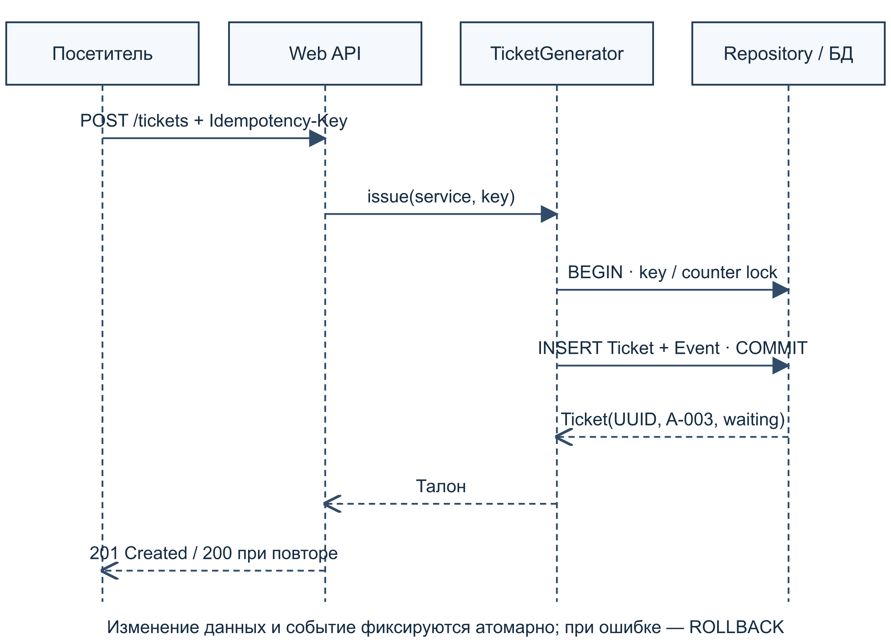
Рисунок 10. UML последовательности выдачи талона

При выдаче терминал посылает услугу и уникальный Idempotency-Key. API проверяет доступность услуги и передаёт команду TicketGenerator. Репозиторий в транзакции проверяет ключ, изменяет счётчик, создаёт Ticket и событие. Ответ 201 содержит выданный талон. Повтор того же запроса возвращает прежний UUID с кодом 200; недоступная услуга даёт 409. Если фиксация не состоялась, клиенту нельзя показывать талон как выданный. Сценарий вызова показан на рисунке 11.

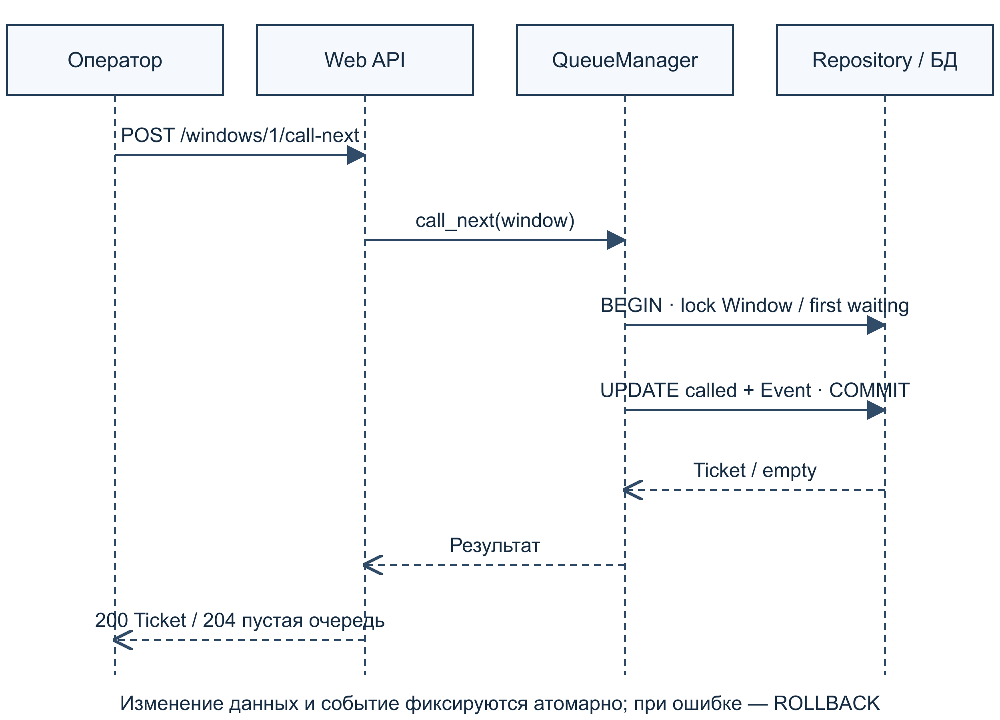
Рисунок 11. UML последовательности вызова следующего

При вызове API проверяет сотрудника и назначение окна. QueueManager блокирует окно и первый ожидающий талон, сохраняет called и событие, затем возвращает результат. Пустая очередь даёт 204 без создания фиктивного талона. Занятое окно либо недопустимый переход дают 409. Информационное табло получает уже зафиксированное состояние через отдельное чтение, поэтому не показывает неуспешный вызов.

## 3.4 Диаграмма деятельности

Диаграмма деятельности детализирует работу оператора. Начальное и конечное состояния отмечены соответствующими узлами UML, действия — скруглёнными прямоугольниками, выборы — ромбами с альтернативами Да и Нет. Первый выбор обрабатывает отсутствие ожидающего талона, второй — неявку посетителя. Деятельность оператора представлена на рисунке 12.

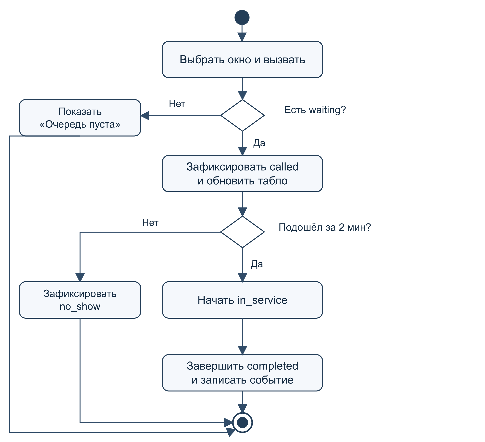
Рисунок 12. UML деятельности обслуживания посетителя

После успешного вызова фиксируется called и обновляется табло. При прибытии оператор начинает обслуживание, затем завершает его. При отсутствии посетителя неявка отмечается только после заданного интервала. Схема согласована с BPMN: бизнес-задача «Обслужить» разложена здесь на начало и завершение. Диаграмма состояний, в свою очередь, определяет допустимость каждой из этих команд.

## 3.5 Прототип интерфейса

Разработан локальный интерактивный прототип HTML/CSS/JavaScript с пятью экранами. Выбор роли организован навигацией, чтобы просмотреть рабочие сценарии без отдельных учётных записей. Это демонстрация поведения интерфейса. Реальная аутентификация, многопользовательские транзакции, печать и соединение с PostgreSQL относятся к последующей серверной реализации. Карточка посетителя представлена на рисунке 13.

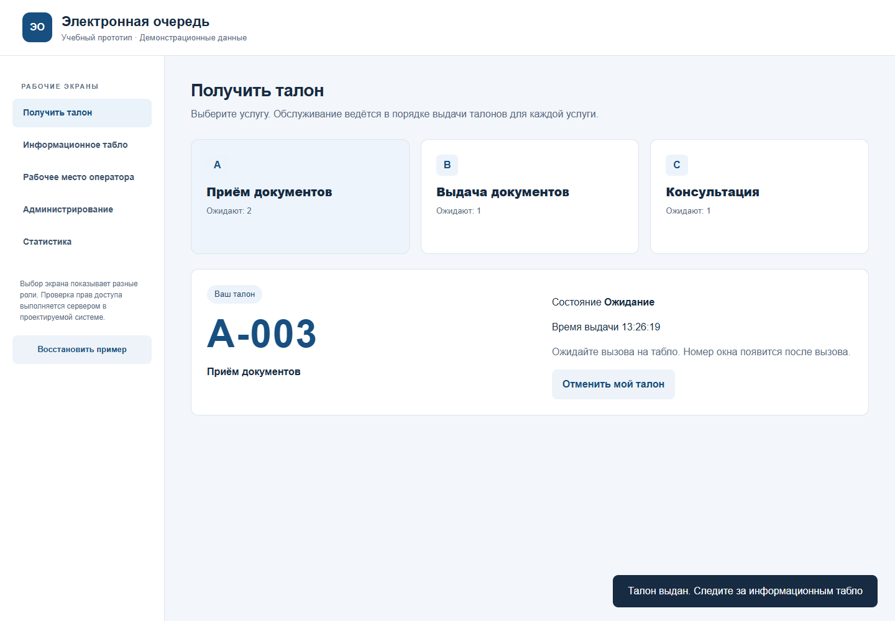
Рисунок 13. Карточка выданного талона на экране посетителя

Экран посетителя предлагает три услуги, показывает номер и время созданного талона. Карточка состояния объясняет ожидание; до вызова доступна отмена своего талона. Повторная выдача увеличивает последовательность. При закрытии услуги кнопка недоступна и снабжена понятной подписью. Для будущего сервера владение талоном подтверждается отдельным непредсказуемым токеном, а не отображаемым номером. Текущий талон оператора показан на рисунке 14.

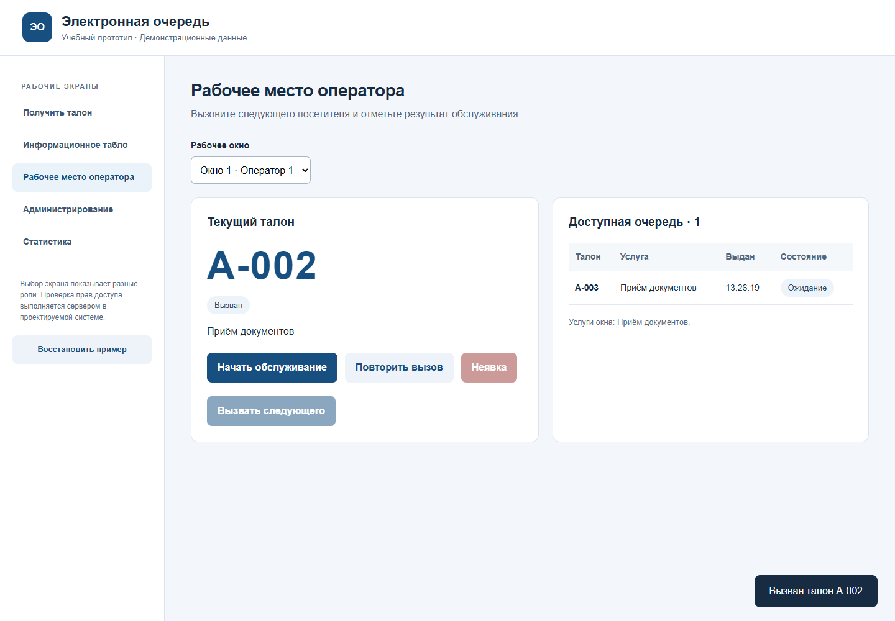
Рисунок 14. Текущий талон на рабочем месте оператора

Оператор выбирает своё рабочее окно и видит допустимую очередь. Пока активный талон не завершён, следующий вызов заблокирован. После вызова доступны начало обслуживания, повтор и неявка; последняя становится доступна после двух минут. Кнопка завершения появляется после начала. Такое построение уменьшает вероятность недопустимого перехода, однако окончательное решение всегда должно проверяться на сервере. Вызовы к окнам показаны на рисунке 15.

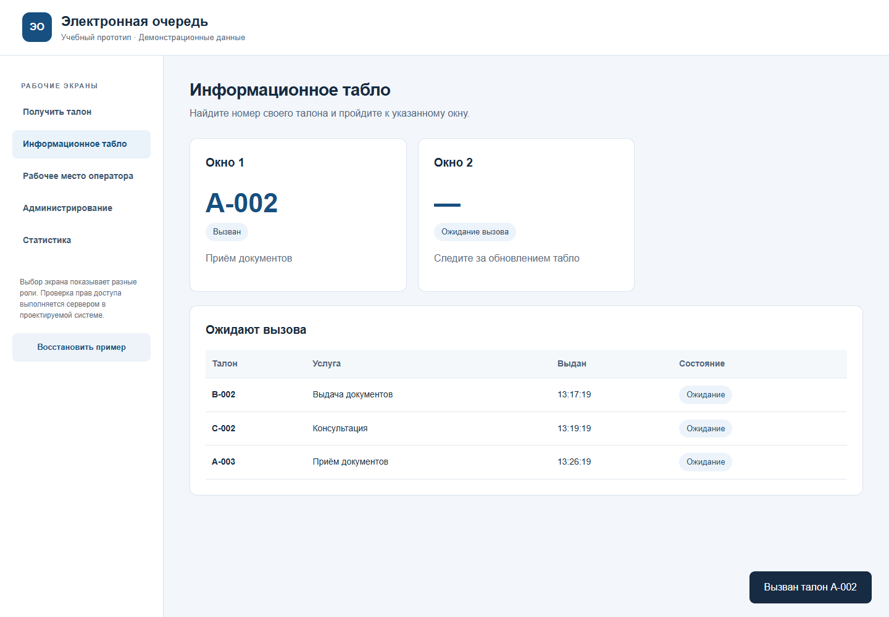
Рисунок 15. Информационное табло

Табло показывает для каждого окна текущий номер и состояние. При отсутствии вызова выводится нейтральная подпись. Ожидающие номера отделены от вызванных, личные данные посетителей не отображаются. Для внедрения можно добавить звуковое оповещение как отдельный адаптер без изменения основной модели талона. Управление услугами показано на рисунке 16.

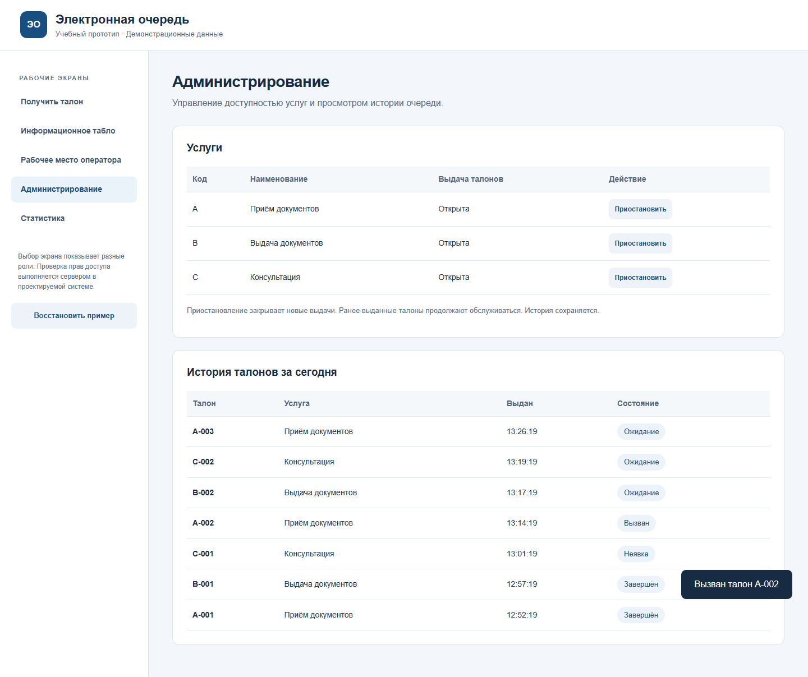
Рисунок 16. Управление услугами на экране администратора

Администратор управляет доступностью выдачи по услугам и просматривает историю. Приостановление не удаляет старые талоны. Изменение состава услуг окон и назначение сотрудников предусмотрены серверным проектом и моделью данных; в локальном интерфейсе они представлены фиксированным примером двух окон. Статистика по услугам показана на рисунке 17.

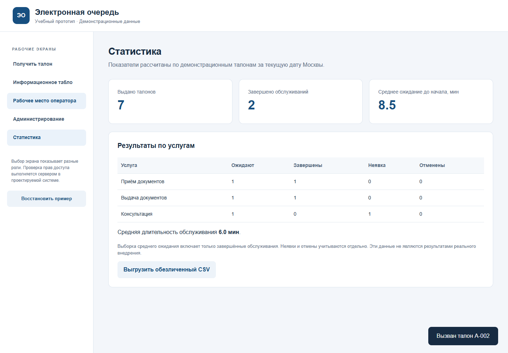
Рисунок 17. Статистика обслуживания по услугам

Статистика рассчитывается по демонстрационным данным. Среднее ожидание учитывает завершённые обслуживания; отмены и неявки показаны отдельно. Доступна обезличенная выгрузка CSV. Начальные состояния служат примером и не являются измерениями реального внедрения.

# 4 Технические решения и обеспечение качества

## 4.1 Интеграции и контракт обмена

Обязательная интеграция первой версии связывает терминал, табло и рабочие места с API системы. Для обмена выбран HTTPS и JSON в UTF-8. Временные отметки передаются в ISO 8601 с зоной UTC. Контракт описан в OpenAPI 3.1.1, позволяющем проверять параметры, схемы ответов и ошибки независимо от программного языка [6]. Операции обмена представлены в таблице 8.

Таблица 8. Основные операции HTTP API
| Операция | Назначение | Основной ответ |
| --- | --- | --- |
| GET /api/services | Доступные услуги | 200, массив услуг |
| POST /api/tickets | Выдача с service_id и Idempotency-Key | 201 новый или 200 прежний талон; 409 услуга закрыта |
| GET /api/display | Текущие вызовы без личных данных | 200, номера и окна |
| POST /api/windows/{id}/call-next | Вызов для своего окна | 200 талон; 204 очередь пуста; 409 окно занято |
| POST /api/tickets/{id}/actions | start, complete, repeat_call, mark_no_show, cancel | 200 результат; 403 нет права; 409 переход запрещён |
| PATCH /api/services/{id} | Изменение доступности администратором | 200 обновлённая услуга; 403 нет права |
| GET /api/statistics | Показатели за рабочую дату | 200 агрегаты; 403 нет права |
| GET /api/export | Обезличенная выгрузка | 200 text/csv, UTF-8 |

Ошибки имеют единый объект code, message и request_id. Пароли и секреты в сообщения не включаются. При временном сетевом сбое повторяется выдача с прежним ключом. Для команд состояния необходима проверка текущего статуса и версии: повтор complete не должен повторно записывать окончание обслуживания. Табло выполняет только чтение с частотой раз в секунду; разрыв связи должен сопровождаться признаком устаревания данных.

Интеграция с принтером талонов возможна через локальный адаптер печати, а со службой уведомлений — через отдельный адаптер сообщений. Печать запускается после успешной регистрации талона; ошибка принтера не должна выдавать новый номер при повторе. Система идентификации организации может заменить локальные учётные записи позднее. Эти интеграции не являются обязательными зависимостями локального прототипа и требуют проверки конкретного оборудования.

## 4.2 Выбор технологии разработки

Python сохранён как технологическая основа РР1. Flask выбран для небольшого серверного приложения, поскольку его маршруты и модульная структура соответствуют ограниченному набору операций; официальная документация определяет его как WSGI веб-фреймворк [8]. SQLAlchemy обеспечивает доступ к данным и явные границы транзакций [11]. PostgreSQL выбран для ограничений целостности и блокировок конкурентного обслуживания [9]. Технические варианты сопоставлены в таблице 9.

Таблица 9. Сопоставление технических вариантов
| Область | Альтернатива | Выбор и основание |
| --- | --- | --- |
| Сервер | Flask, Django, FastAPI | Flask: преемственность РР1 и небольшой объём; Django даёт больше готовых механизмов, FastAPI полезен при развитии типизированного API |
| Хранение | Файлы, SQLite, PostgreSQL | PostgreSQL: одновременные вызовы и ограничения БД; файлы не обеспечивают нужную транзакционную модель |
| Клиент | Серверные страницы, SPA | Простые веб-экраны без сложной SPA; прототип работает локально без сборки |
| Архитектура | Монолит, микросервисы | Модульный монолит для одного учреждения и общей транзакции |
| Версионирование | Разрозненные файлы, Git | Исходный GitHub-репозиторий, согласованная версия схем, кода и документации |

При реализации фиксируются совместимые версии зависимостей и миграций; выбор последней версии сам по себе не заменяет проверку совместимости. Для времени используются значения datetime с явно заданной временной зоной: наивные значения не позволяют однозначно определить момент события [10]. Секреты передаются через конфигурацию окружения вне репозитория.

## 4.3 Стратегия тестирования

Проверка строится от бизнес-правил к инфраструктуре. Модульные тесты охватывают переходы и расчёт метрик; интеграционные — реальные транзакции БД, ограничения, роли и API; сквозные — сценарии посетителя и оператора. Приёмочный набор связан с кодами требований, поэтому пропуск конкретной проверки виден в матрице. Ключевые проверки приведены в таблице 10.

Таблица 10. Ключевые тесты проектируемой системы
| Тест | Код | Действие и ожидаемый результат | Уровень |
| --- | --- | --- | --- |
| T01 | F01, N05 | Две выдачи на услугу дают разные последовательности; одинаковый ключ возвращает один UUID | API и БД |
| T02 | F02, N02 | Вызов появляется на табло в пределах 3 с; чужие данные не показываются | Сквозной |
| T03 | F03, N05 | Два окна вызывают два разных талона; первое окно получает ранний waiting | Конкурентный |
| T04 | F03 | Повтор вызова занятого окна возвращает 409 без второго активного талона | API и БД |
| T05 | F04, F10 | Повторный вызов не меняет called_at; переход и событие сохраняются атомарно | Модульный и БД |
| T06 | F09, F07 | Свой waiting отменяется, чужой талон и called отклоняются | API и безопасность |
| T07 | F10 | На 119-й секунде no_show запрещён, на 120-й допустим | Граничный |
| T08 | F05, F08 | Пустая выборка не даёт NaN; среднее и CSV совпадают с контрольными данными | Модульный |
| T09 | F06 | После закрытия услуги новая выдача запрещена, ранее выданный талон доступен оператору | Сквозной |
| T10 | N01, N03 | Измеряются перцентили задержек и ошибки при заданной нагрузке | Нагрузочный и мониторинг |
| T11 | N04 | Копия развёрнута на отдельном стенде, история читается, RPO/RTO измерены | Восстановление |
| T12 | N06, N07 | Клавиатурный проход, узкий экран и граница московской даты | Интерфейс и граничный |

В рамках работы выполнена автоматизированная проверка локального прототипа в изолированном браузерном сеансе: 21 сценарная проверка завершилась успешно. Проверены выдача и уникальные номера, отмена, приостановление выдачи, FIFO, занятое окно, повтор вызова, запрет ранней неявки, начало и завершение, допустимая неявка, пустая очередь, сохранение после перезагрузки, CSV, экранирование текста и ширина 390 px. Сохранены снимки всех пяти экранов.

Перечисленный результат относится к клиентскому прототипу. Конкурентные запросы к PostgreSQL, серверные роли, идемпотентность HTTP, восстановление и нагрузочные целевые значения остаются приёмочными проверками будущей реализации. Для выпуска требуется отсутствие критических дефектов и прохождение всех обязательных критериев F01–F10 и N01–N08 на целевом стенде.

## 4.4 Модель развёртывания

Развёртывание предусматривает клиентские устройства, сервер приложения, сервер БД и отдельное хранилище резервных копий. Стереотипы device, executionEnvironment и artifact разделяют оборудование, среду выполнения и развёрнутые программные артефакты [5]. Для небольшого пилота приложение и БД могут находиться на одном физическом узле с сохранением изоляции сетевых доступов. Развёртывание системы показано на рисунке 18.

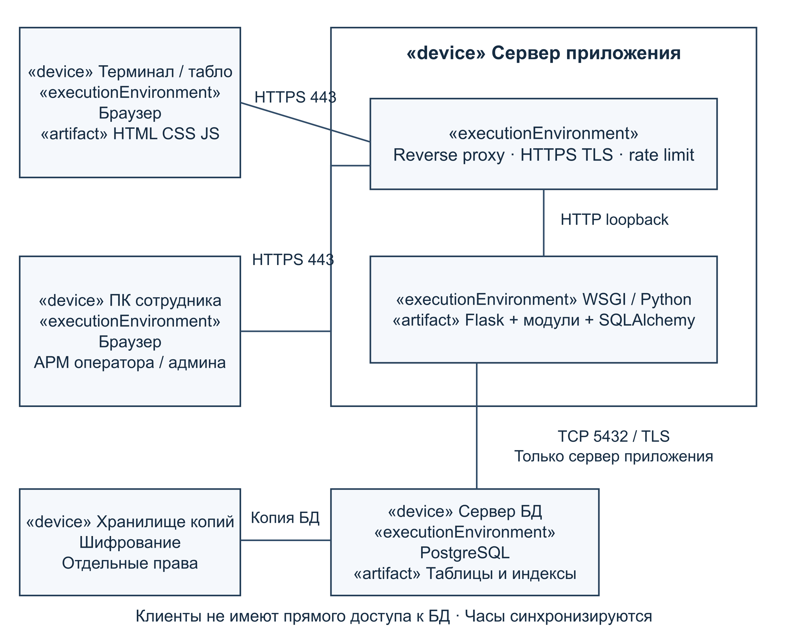
Рисунок 18. UML развёртывания системы

Терминал, табло и ПК сотрудника используют браузер и HTTPS 443. Обратный прокси завершает TLS, ограничивает частоту запросов и направляет обращения WSGI-приложению по локальному соединению. Flask, прикладные модули и SQLAlchemy работают внутри этого процесса. Только сервер приложения может обращаться к PostgreSQL на TCP 5432; прямой доступ клиентов запрещён. Отдельное хранилище копий не использует учётную запись приложения.

Начальная конфигурация для оценки на стенде — 2 процессорных ядра, 4 ГБ памяти и 20 ГБ диска для приложения, отдельный объём под БД и копии. Это отправная точка измерений, а не подтверждённая достаточность ресурсов. Перед запуском выполняются миграции, тест соединения, проверка часов, учётных записей и контрольный сценарий выдачи. После обновления сохраняется возможность отката к совместимой версии приложения и восстановленной копии БД.

## 4.5 Безопасность

Основные угрозы — несанкционированный вызов, подмена команд, получение чужого талона, внедрение кода через названия, подбор паролей и утрата истории. Для проектирования проверок используется OWASP ASVS 5.0.0 как открытый набор требований к веб-приложениям [7]. Приведённые меры не означают подтверждённого соответствия всему стандарту. Угрозы и меры представлены в таблице 11.

Таблица 11. Угрозы и проектные меры
| Угроза | Мера | Проверка |
| --- | --- | --- |
| Действие от имени другого окна | Роль на сервере и связь сотрудника с окном | Оператор окна 1 не вызывает окно 2 |
| Подмена или повтор команды | Проверка состояния, версии и права; защита CSRF для сеансов cookie | Недопустимая команда возвращает 403 или 409 |
| XSS и SQL-инъекция | Экранирование вывода, проверка входов, параметризованные запросы | Строки с разметкой отображаются как текст |
| Перехват сеанса и подбор пароля | TLS, хеширование паролей, безопасные cookie, ограничение попыток | Проверка конфигурации и негативные тесты |
| Доступ к чужому талону | UUID и отдельный токен владения; номер на табло не даёт права отмены | Отмена без токена отклоняется |
| Удаление либо подмена истории | Минимальные права БД, транзакционные события, копии и аудит | Восстановление и сопоставление событий |

Посетитель видит только свою карточку и публичные вызовы. Оператор получает очередь своего окна и команды обслуживания. Администратор управляет справочниками и отчётами; эта роль не должна автоматически получать возможность бесследно удалять события. Техническая учётная запись приложения не имеет прав управления пользователями СУБД. Журналы не содержат паролей, токенов владения и строк подключения.

Для учебного проекта принят срок оперативного хранения обезличенной истории 90 дней; окончательный срок и порядок доступа должны быть утверждены организацией перед внедрением. В прототипе нет действующего механизма авторизации и автоматического удаления по сроку. Проверка экранирования клиентского текста подтверждает один сценарий интерфейса, но не заменяет проверку безопасности серверного приложения.

## 4.6 Метрики эффективности

Метрики рассчитываются по событиям одной рабочей даты и услуги. Ожидание определяется от создания до начала обслуживания, а не до вызова. Основная выборка включает completed; no_show и cancelled исключаются из среднего и показываются отдельными долями. Если завершённых талонов нет, среднее не определено и выводится прочерк.

$$W_{\text{ср}}=\frac{\sum_{i=1}^{N}(t_{\text{нач},i}-t_{\text{выд},i})}{N}\tag{1}$$

Здесь Wср — среднее ожидание, мин; N — число завершённых обслуживаний; tнач и tвыд — время начала обслуживания и выдачи талона. Длительность обслуживания определяется аналогично как разность времени завершения и начала.

$$S_{\text{ср}}=\frac{\sum_{i=1}^{N}(t_{\text{кон},i}-t_{\text{нач},i})}{N}\tag{2}$$

Вторая формула задаёт среднюю длительность Sср в минутах. Для оценки длинного ожидания дополнительно рассчитывается 90-й перцентиль: значения сортируются и берётся элемент с номером, равным округлённому вверх произведению 0,9 и N. Доступность оценивается только за объявленные часы работы.

$$A=\frac{T_{\text{работы}}-T_{\text{простоя}}}{T_{\text{работы}}}\times100\%\tag{3}$$

В третьей формуле A — доступность в процентах, Tработы — длительность наблюдаемого периода работы, Tпростоя — время недоступности обязательных операций. Периоды и правила классификации сбоя должны быть одинаковыми при сравнении до и после внедрения. Показатели и целевые ориентиры приведены в таблице 12.

Таблица 12. Показатели и использование на пилоте
| Показатель | Расчёт и единица | Проектная цель или решение |
| --- | --- | --- |
| Среднее ожидание | Среднее tнач − tвыд, мин | Наблюдение по услугам; сравнение с ручным порядком при сопоставимой нагрузке |
| P90 ожидания | 90-й перцентиль завершённых, мин | Начальный ориентир не более 20 мин; уточняется по данным пилота |
| Пропускная способность | Завершённые талоны за час | Сопоставление с числом открытых окон |
| Доля неявок | no_show / все выданные × 100 процентов | Анализ причин при росте, без подмены отмен неявкой |
| Доля отмен | cancelled / все выданные × 100 процентов | Контроль понятности выбора услуги |
| Техническая задержка | P95 выдачи и вызова, с | Не более 2 с при нагрузке N01 |
| Доступность и восстановление | A, RPO и RTO | Не ниже 99,5 процента; RPO ≤ 24 ч, RTO ≤ 60 мин |

Снижение ожидания нельзя приписывать системе без наблюдения сопоставимых периодов и состава услуг. В работе не заявляется достигнутое ускорение обслуживания: прототип проверяет расчёт и представление данных, а эффективность определяется после пилота.

# 5 Проектная документация и внедрение

## 5.1 Сокращённое техническое задание

Задача раздела — зафиксировать содержание будущего программного продукта и условия его приёмки. Нормативным ориентиром выбран ГОСТ 34.602-2020 «Техническое задание на создание автоматизированной системы». Действующий статус и область применения проверены по официальному фонду Росстандарта [1]. Ниже представлена учебная сокращённая спецификация; комплект организационных реквизитов реального договора формируется при внедрении.

Общие сведения. Наименование — информационная система электронно-информационной очереди, сокращённо ИС «Электронная очередь». Основание разработки — учебное задание по дисциплине «Проектная деятельность в ИТ», вариант М, с продолжением исходного проекта РР1. Разработчик учебного проекта — Макаров Анатолий Александрович. Программные и проектные материалы относятся к исходному публичному репозиторию electronic-queue.

Назначение и цели. Система предназначена для упорядочения очного обслуживания в одном учреждении. Цели — регистрировать обращения, обеспечивать однозначный вызов к окну, сохранять историю и получать измеримые показатели ожидания. Успех приёмки определяется критериями F01–F10 и N01–N08, а не только наличием пользовательских экранов.

Характеристика объекта. Объект автоматизации включает посетителей, терминал выдачи, информационное табло, до десяти окон и ответственного за справочники. Для проектной оценки приняты до 1000 талонов в день и до 30 одновременных клиентских сеансов. Идентификация посетителя по ФИО и содержание предоставляемой услуги находятся вне границы системы.

Требования к системе. Функции определены в разделе 1.3, данные — в ER-моделях, переходы — в разделе 2.5. Система обязана обеспечивать уникальную выдачу, недопустимость двойного вызова и согласованную историю. Требования к нагрузке, доступности, восстановлению, времени и интерфейсу заданы N01–N08. Доступ к изменению справочников и отчётам предоставляется по роли. Целевые устройства и сетевые границы показаны на модели развёртывания.

Состав работ. Сохраняются пять этапов ИСР РР1: анализ требований, проектирование архитектуры, разработка модуля талонов, разработка логики очереди и тестирование. Результаты этапов — версия требований, комплект моделей, серверные модули, интерфейсы, миграции и протокол приёмки. Локальный прототип РР2 является результатом проектирования интерфейса; он не заменяет серверные модули.

Порядок разработки и контроля изменений. Каждый выпуск связывает одну версию требований, схем, миграций и кода. Изменение статуса или бизнес-правила требует обновления соответствующей диаграммы и теста. Предлагаемое размещение проектных материалов — docs/rr2 и prototype/rr2 исходного репозитория с просмотром изменений владельцем перед включением в develop.

Контроль и приёмка. Сначала выполняются модульные и интеграционные проверки, затем сквозные, конкурентные, нагрузочные и восстановление. Протокол содержит среду, входные данные, ожидаемый и фактический результат и обнаруженные дефекты. Критические ошибки уникальности, доступа и утраты данных блокируют выпуск. После пилота ответственный представитель организации подтверждает пригодность рабочих сценариев.

Подготовка объекта к вводу. Необходимо установить терминал и табло, назначить сотрудников и окна, заполнить справочники услуг, проверить сетевые подключения, часы и резервное копирование. Перед открытием смены выполняется контрольный талон. Резервный ручной порядок обслуживания и ответственный за переключение определяются заранее.

Документирование. Комплект включает отчёт, редактируемые схемы и экспорты, исходники прототипа, требования, словарь данных, проект DDL, контракт OpenAPI, план тестирования и инструкцию демонстрации. Для промышленного выпуска дополнительно нужны эксплуатационная инструкция, конфигурация развёртывания, миграции и фактические протоколы испытаний. Источниками разработки служат РР1, профильное задание, требования репозитория и использованные нормативные и технические первоисточники.

## 5.2 План внедрения

Внедрение выполняется после реализации серверной части и прохождения обязательных проверок. Длительности в таблице являются оценкой последовательности для одного учреждения. Они не устанавливают согласованный календарь реального заказчика. Этапы внедрения приведены в таблице 13.

Таблица 13. Этапы внедрения и условия перехода
| Этап | Оценка | Результат и условие перехода |
| --- | --- | --- |
| Обследование и уточнение | 2 рабочих дня | Согласованы услуги, окна, правила неявки, нагрузка и ответственные |
| Подготовка стенда | 2 рабочих дня | Настроены сеть, учётные записи, миграции, часы и копии; тест восстановления успешен |
| Обучение и пробный прогон | 1 рабочий день | Сотрудники проходят выдачу, вызов, неявку и резервный порядок |
| Ограниченный пилот | 5 рабочих дней | Одно или два окна, ежедневный разбор дефектов и метрик; нет критических ошибок |
| Расширение и сопровождение | После приёмки пилота | Подключены остальные окна; назначены мониторинг, обновления и контроль копий |

На пилоте сохраняется возможность организованного возврата к ручному порядку. При сбое прекращается электронная выдача и сотрудник объявляет единый резервный порядок, чтобы не создать две независимые очереди. Уже выданные номера сверяются с журналом; после восстановления неразобранные записи проверяются до возобновления выдачи. Откат обновления допускается только при совместимости схемы данных либо после восстановления проверенной копии.

Переход к расширению возможен при отсутствии двойного вызова, потери истории и нарушений полномочий, а также при достижении N01, N02 и N04 на пилотном стенде. Если показатели не достигнуты, уточняются конфигурация и ограничения, затем проверки повторяются. Решение о масштабировании принимается по наблюдаемым данным, а не по внешнему виду прототипа.

## 5.3 Сравнение методов проектирования

Структурный подход полезен для описания границ и преобразования информации: IDEF0 показывает, что поступает в систему и какие результаты получаются. Объектно-ориентированный подход связывает данные талона с состояниями, допустимыми операциями и ответственностью классов. Оба рассматриваются применительно к одной и той же задаче очереди. Методы проектирования сопоставлены в таблице 14.

Таблица 14. Сравнение методов проектирования
| Критерий | Структурный подход | Объектно-ориентированный подход |
| --- | --- | --- |
| Основная единица | Функция и поток данных | Объект, класс и взаимодействие |
| Представление процесса | Декомпозиция A0 на A1–A3 | Сценарии, деятельность и состояния Ticket |
| Представление данных | Отдельная модель хранения | Атрибуты и операции предметных классов |
| Сильная сторона | Видимые границы и зависимости функций | Контроль жизненного цикла и расширение поведения |
| Риск применения | Разрыв между процессом и программными объектами | Излишние классы без связи с бизнес-целью |

Для системы выбран объектно-ориентированный подход, поскольку Ticket и QueueManager определяют правила обслуживания. IDEF0 проверяет полноту входов, выходов и ресурсов, BPMN связывает роли с действиями. Требования соединяют модели и проверки. Например, F03 связан с бизнес-процессом, QueueManager, транзакцией вызова и тестами T03–T04.

# ЗАКЛЮЧЕНИЕ

Разработан проект ИС электронно-информационной очереди как продолжение РР1. Для предметной области установлены границы очного обслуживания, сохранена исходная ИСР из пяти этапов и выделены участники, справочники, талоны и история. Определены десять функциональных и восемь нефункциональных требований с наблюдаемыми критериями, что связывает пользовательские проблемы с будущей приёмкой.

Бизнес-процесс представлен в BPMN и IDEF0. Разработаны архитектура модульного монолита, ER-модель основных и вспомогательных сущностей и UML классов. Для талона определены шесть состояний и допустимые переходы. Риски оценены по вероятности и влиянию; предложены меры против двойного вызова, повторной выдачи, утраты истории и нарушения доступа. Для продолжения каскадной ИСР обоснованы итерации реализации с проверкой результата каждого цикла.

Диаграммы последовательностей раскрывают выдачу и вызов, диаграмма деятельности — работу оператора. Создан прототип пяти экранов; 21 сценарная проверка завершилась успешно. Этот результат относится к локальному интерфейсу; серверные механизмы требуют отдельной реализации и испытаний.

Определены интеграции HTTPS/JSON и CSV, выбран стек Python, Flask, SQLAlchemy и PostgreSQL. Подготовлены стратегия тестирования, модель развёртывания и требования безопасности. Метрики отделяют ожидание от обслуживания, успешные обращения от неявок и проектные ориентиры от будущих измерений. Сокращённое ТЗ фиксирует функции, качество, состав работ, контроль и документацию. План внедрения предусматривает стенд, обучение, ограниченный пилот и условия расширения.

Объектно-ориентированное проектирование дополнено структурными моделями процессов. Следующий этап — серверная реализация и проверка транзакций, полномочий, производительности и восстановления.

# СПИСОК ИСПОЛЬЗОВАННЫХ ИСТОЧНИКОВ

1. ГОСТ 34.602-2020. Информационные технологии. Комплекс стандартов на автоматизированные системы. Техническое задание на создание автоматизированной системы. Официальная карточка Росстандарта. URL: https://protect.gost.ru/gost/details/5876f733-ee91-431a-8cb6-9e02ea2436ac (дата обращения 04.11.2026).

2. electronic-queue. Исходный проект и требования к ИС электронной очереди. Репозиторий iONEimee. Снимок develop 408e1b8bba8036013b1a76cd841f2d5b3c7e37bb. URL: https://github.com/iONEimee/electronic-queue (дата обращения 04.11.2026).

3. National Institute of Standards and Technology. Integration Definition for Function Modeling IDEF0. FIPS PUB 183. Первоначальная спецификация нотации. URL: https://nvlpubs.nist.gov/nistpubs/Legacy/FIPS/fipspub183.pdf (дата обращения 04.11.2026).

4. Object Management Group. Business Process Model and Notation. Version 2.0.2. Спецификация. URL: https://www.omg.org/spec/BPMN/2.0.2 (дата обращения 04.11.2026).

5. Object Management Group. Unified Modeling Language. Version 2.5.1. Спецификация. URL: https://www.omg.org/spec/UML/2.5.1 (дата обращения 04.11.2026).

6. OpenAPI Initiative. OpenAPI Specification. Version 3.1.1. URL: https://spec.openapis.org/oas/v3.1.1.html (дата обращения 04.11.2026).

7. OWASP Foundation. Application Security Verification Standard. Version 5.0.0. 2025. URL: https://asvs.owasp.org/ (дата обращения 04.11.2026).

8. Pallets. Flask Documentation. Официальная документация. URL: https://flask.palletsprojects.com/en/stable/ (дата обращения 04.11.2026).

9. PostgreSQL Global Development Group. PostgreSQL Documentation. Explicit Locking. URL: https://www.postgresql.org/docs/current/explicit-locking.html (дата обращения 04.11.2026).

10. Python Software Foundation. datetime — Basic date and time types. Официальная документация. URL: https://docs.python.org/3/library/datetime.html (дата обращения 04.11.2026).

11. SQLAlchemy. Transactions and Connection Management. Официальная документация. URL: https://docs.sqlalchemy.org/en/20/orm/session_transaction.html (дата обращения 04.11.2026).

12. World Wide Web Consortium. Web Content Accessibility Guidelines WCAG 2.2. Рекомендация от 12 декабря 2024. URL: https://www.w3.org/TR/WCAG22/ (дата обращения 04.11.2026).
